  

###

  
  
  

###

<h1 data-importer="text" align="center">André Felipe de Moraes 👽</h1>

###

<h2 data-importer="text" align="left">Sobre mim ☝️🤓:</h2>

###

  Sou apaixonado por tecnologia e desenvolvimento de software. Gosto de explorar novas ferramentas, entender como os sistemas funcionam e transformar ideias em soluções práticas.

  Tenho interesse especial pelo desenvolvimento <b>Back-end</b>, bancos de dados, integração de sistemas e automação de processos. Busco explorar o desenvolvimento <b>Full Stack</b>, experimentando diferentes tecnologias e ampliando meus conhecimentos.

  Atualmente, estudo <b>Engenharia de Software</b> no Instituto Infnet e desenvolvimento Full Stack pelo curso.dev. Neste espaço, compartilho projetos, estudos e experimentos que fazem parte da minha jornada na programação.

  Acredito que aprender a desenvolver é um processo contínuo: testar, investigar, errar, encontrar soluções e melhorar a cada projeto. 🚀

###

<h3 data-importer="text" align="left">Meu status 🔥:</h3>

###

  

###

<h3 data-importer="text" align="left">Conquistas 🏆:</h3>

###

<picture data-importer="pacman">
  <source media="(prefers-color-scheme: dark)" srcset="https://raw.githubusercontent.com/o0andrefelipe0o/o0andrefelipe0o/pacman-output/galaga-contribution-graph-dark.svg?game=galaga">
  <source media="(prefers-color-scheme: light)" srcset="https://raw.githubusercontent.com/o0andrefelipe0o/o0andrefelipe0o/pacman-output/galaga-contribution-graph.svg?game=galaga">
  
</picture>

###

  

###

<h3 data-importer="text" align="left">Estatísticas 📈:</h3>

###

  

    
    
  

   

###

  

###

<h3 data-importer="text" align="left">Tecnologias e ferramentas 🛠:</h3>

###

  
  
  
  
  

  

  
  
  
  
  

  
  
  
  
  

  
  
  
  
  
  
  
  
  

  
  
  
  
  
  
  
  
  
  
  
  
  

  
  
  
  
  

  
  
  

  
  
  
  
  

###

  
  &nbsp;&nbsp;
  
  &nbsp;&nbsp;
  

  Obrigado pela visita! 🛸

###

<!--
**o0andrefelipe0o/o0andrefelipe0o** is a ✨ _special_ ✨ repository because its `README.md` (this file) appears on your GitHub profile.

Here are some ideas to get you started:

- 🔭 I’m currently working on ...
- 🌱 I’m currently learning ...
- 👯 I’m looking to collaborate on ...
- 🤔 I’m looking for help with ...
- 💬 Ask me about ...
- 📫 How to reach me: ...
- 😄 Pronouns: ...
- ⚡ Fun fact: ...
-->
